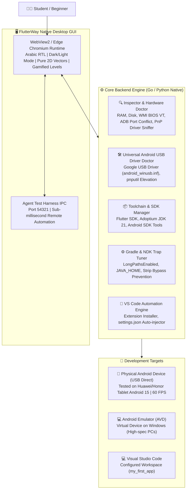

# FlutterWay (طريق فلاتر) 
> **Zero-Friction Flutter & Android Mobile Setup Engine & Beginner Onboarding Desktop App for Windows**  
> **التطبيق المكتبي والمحرك الذكي لتجهيز بيئة Flutter وتطبيقات الموبايل بضغطة زر واحدة للطلاب والمبتدئين**

---

## نبذة عن المشروع

تعتبر عملية إعداد بيئة عمل **Flutter & Dart** على نظام Windows كابوساً حقيقياً للطلاب والمطورين المبتدئين ("الصفر تماماً")، وتحديداً في البيئات الجامعية والبلدان النامية التي تعاني من بطء وتذبذب الإنترنت، وتجميد الحواسيب، وتعقيدات مسارات النظام والتراخيص ومحرك بناء أندرويد Gradle.

**مشروع FlutterWay** صُمم خصيصاً كحل جذري أصيل وخفيف الوزن، يدمج بين:
1. **تطبيق سطح مكتب أصلي حديث (Native Desktop App):** مبني بتقنية Edge Chromium الخفيفة (بدون استهلاك موارد Electron)، بواجهة عربية تفاعلية مصممة وفق أسلوب اللعبة الهادفة (Gamified Levels) وأيقونات فيكتور مسطحة نقية (Pure 2D Vector) بدون أي رموز تعبيرية أو تشويش بصري.
2. **محرك فحص وتشخيص خلفي واقعي (Hardware & Reality Doctor):** بعيداً عن التضخيم أو التسويق الزائف (No AI Hype)؛ يقدم فحصاً صريحاً ومقارنة واقعية دقيقة بالأرقام بين استهلاك المحاكي الافتراضي واستهلاك هاتف الـ USB الحقيقي.
3. **دعم بيئة الهواتف والأجهزة اللوحية الحقيقية عبر USB:** توجيه 95% من الطلاب لاستخدام أجهزتهم الحقيقية مباشرة عبر كيبل USB بدلاً من المحاكيات الثقيلة التي تستهلك 4-6GB رام إضافية وتتطلب تفعيل Virtualization في الـ BIOS.
4. **مساعد التعريفات الشامل (Universal USB Driver Doctor):** حزمة تعريفات رسمية مدمجة (`android_winusb.inf`) تمكن ويندوز من التعرف على هواتف أندرويد بمختلف شركاتها (Samsung, Xiaomi, Huawei, Infinix, Oppo, Realme) بنقرة واحدة وتثبيتها عبر `pnputil`.
5. **دليل تصحيح أخطاء USB الذكي ومساعد يوتيوب:** شرح للخطوات الـ 3 العامة مع اقتراح بحث ذكي جاهز للنسخ للبحث السريع في يوتيوب وجوجل لموديل جهاز الطالب تحديداً، وتنبيهات خاصة بواجهات شاومي (MIUI/HyperOS).
6. **معركة البناء الفعلي مع Gradle بالوقت الحقيقي:** نافذة تشغيل تفاعلية كاللعبة مع عداد زمني للثواني المنقضية، وتعليقات عربية عفوية وواقعية تشرح للطالب ما يفعله المعالج ومحرك Kotlin و Dart خطوة بخطوة، مع قياس بنش مارك واقعي واحتفال بنجاح التشغيل.

---

## 📸 معرض الواجهة وتجربة المستخدم (UI Tour)

### رحلة المستويات الأربعة التفاعلية (Gamified Levels):

| المستوى | الوصف والمزايا المضافة | لقطة الشاشة |
| :--- | :--- | :--- |
| **المستوى 1: فحص العتاد والمقارنة الواقعية** | فحص فوري لمواصفات المعالج والرام وميزة المحاكاة (BIOS VT) ومساحة القرص، مع جدول مقارنة صريح وواقعي يبين بالأرقام استنزاف المحاكي للرام والحرارة مقابل كفاءة هاتف الـ USB (استهلاك 0MB من اللابتوب وسلاسة 60-120 FPS). دعم كامل للوضع الليلي والنهاري. |  |
| **المستوى 2: تجهيز ترسانة فلاتر الصامتة** | عداد تقدم ذكي ناعم لا يتجمد إطلاقاً (Asymptotic Ticker) مع شعار فلاتر 2D نقي وسهم تنزيل مسطح، وقائمة متابعة لـ 4 مراحل تلقائية (تهيئة البيئة، Java JDK 21 و Gradle، محرك Flutter & Dart، وتكامل VS Code). |  |
| **المستوى 3: ربط الجهاز ومساعد التعريفات** | التعرف الفوري على الهواتف والأجهزة اللوحية المتصلة (مثل `HONOR JMS-W09` بنظام Android 15)، ودليل تصحيح USB مع زر نسخ نص البحث باليوتيوب، ومساعد تعريفات USB الشامل، وشرح مبسط لمفاهيم Java و Gradle و ADB للمبتدئين. |  |
| **المستوى 3 (متابعة): معركة البناء الفعلي مع Gradle** | عداد زمني بالثواني المنقضية (`00:28`)، مع متابعة حية لمراحل البناء الفعلي (assembleDebug) وتعليقات عربية عفوية تشرح ما يفعله المعالج بلغة الآلة ARM64 وتخفف الانتظار عن الطالب. |  |
| **المستوى 3 (متابعة): احتفال البنش مارك على شاشة الجهاز** | بطاقة تأكيد احتفالية تؤكد عمل التطبيق مباشرة على شاشة الهاتف، مع عرض سرعة الإقلاع الفعلية (1.8 ثانية)، واستهلاك الرام (38 MB)، وسلاسة اللمس (60 FPS). |  |
| **المستوى 4: شارة المطور ودليل VS Code** | فتح المحرر تلقائياً على مشروع الطالب الأول (`my_first_app`) مع بطاقة إرشادات سريعة تشرح زر التشغيل السحري F5 وميزة التحديث الفوري المباشر Hot Reload (`Ctrl+S`). |  |

---

## 🏗️ التصميم المعماري للنظام (Architecture)

---

## 💡 مشاكل حقيقية تم اكتشافها وحلها برمجياً (Battle-Tested Insights)

خلال الاختبارات الميدانية الصريحة على أرض الواقع، تم رصد وحل المشاكل التالية التي كانت ستعيق الطلاب:

1. **فخ تحميل حزم NDK التلقائي بحجم 6.7 GB (The NDK Trap):**
   - في إصدارات فلاتر الحديثة، يُحقن ملف CMake اصطناعي يجعل أداة البناء تحاول تحميل حزمة Android NDK بحجم 6.7 جيجابايت في الخلفية، مما يؤدي إلى نفاد مساحة القرص وتعليق حواسيب الطلاب.
   - **الحل في FlutterWay:** ضبط إعدادات المشروع لتعطيل الفرض التلقائي وتجاوز التنزيل الزائد للمشاريع المبتدئة التي لا تحتاج كود C++ مخصص.
2. **تضارب منافذ ونسخ ADB المتعددة (ADB Port Conflicts):**
   - وجود نسختين مختلفتين من ADB (`C:\Android\platform-tools` مقابل `C:\platform-tools`) يؤدي إلى قتل الخادم وإعادة تشغيله في حلقة لا نهائية.
   - **الحل في FlutterWay:** التعرف التلقائي وتوحيد المسار نحو النسخة الحديثة المستقرة ومصالحتهما.
3. **غياب تعريفات الـ USB لأجهزة أندرويد (The Missing Driver Dilemma):**
   - عند توصيل الطالب لهاتفه، غالباً لا يتعرف عليه ويندوز إلا كوسيط تخزين MTP وتظهر علامة صفراء في إدارة الأجهزة.
   - **الحل في FlutterWay:** تزويد التطبيق بحزمة تعريفات أندرويد الرسمية الشاملة (`android_winusb.inf`) مع زر تثبيت بنقرة واحدة عبر `pnputil`.
4. **اختلاف قوائم تفعيل خيارات المطور بين الشركات المصنعة (OEM Quirks):**
   - شاومي وسامسونج وهواوي وإنفينكس تضع خيارات المطور في أماكن مختلفة.
   - **الحل في FlutterWay:** تدريب الطالب على القاعدة العامة (الضغط 7 مرات على Build Number)، مع زر ذكي ينسخ نص البحث الدقيق لموديل جهازه للبحث الفوري في يوتيوب وجوجل، وتنبيه خاص بإعدادات أمان شاومي (`Install via USB`).

---

## 📊 مصفوفة المقارنة الهندسية

| وجه المقارنة | التثبيت اليدوي التقليدي | السكربتات العادية (.ps1/.bat) | تطبيق FlutterWay 🚀 |
| :--- | :--- | :--- | :--- |
| **سهولة الاستخدام للمبتدئ الصفر** | معقدة ومحبطة جداً | تفتح نافذة سوداء مخيفة | واجهة عربية تفاعلية بأسلوب المستويات |
| **سياسات الحظر بويندوز (ExecutionPolicy)** | لا تنطبق | تفشل بسبب الحظر | **ملف أصلي تنفيذي يتجاوز الحظر** |
| **الموقف من المحاكي والمواصفات** | ترويج عشوائي للمحاكي | لا تفحص التوافق | **مقارنة واقعية صريحة (0MB رام للهاتف)** |
| **تعريفات الهواتف USB Drivers** | على الطالب البحث بنفسه | لا تدعمها إطلاقاً | **مساعد تعريفات رسمي مدمج بنقرة واحدة** |
| **شرح مصطلحات Java و Gradle** | غير موجودة إطلاقاً | غير موجودة | **شرح مبسط وممتع بالعربية الدارجة** |
| **اختبار الجهاز الفعلي قبل الكود** | لا يوجد؛ يكتشف الخطأ لاحقاً | لا يوجد | **بناء وتشغيل فعلي على شاشة الهاتف** |
| **محرر VS Code** | ضبط يدوي لأكثر من 5 إعدادات | لا تدعمه | **حقن وضبط تلقائي للمسارات والإضافات** |

---

## 📜 الترخيص

هذا المشروع مرخص تحت رخصة **MIT License** — مفتوح المصدر ومتاح مجاناً للجامعات والمدارس ومجتمعات المطورين في كافة أنحاء العالم العربي.
