# FlutterWay (طريق فلاتر) 
> **Zero-Friction Flutter & Android Mobile Setup Engine & Student Course Companion for Windows**  
> **التطبيق المكتبي والمحرك الذكي لتجهيز بيئة Flutter وتطبيقات الموبايل ورفيق الطالب اليومي للمحاضرات بضغطة زر واحدة**

---

<div dir="rtl">

## نبذة عن المشروع

تعتبر عملية إعداد بيئة عمل **Flutter & Dart** على نظام Windows كابوساً حقيقياً للطلاب والمطورين المبتدئين ("الصفر تماماً")، وتحديداً في البيئات الجامعية والبلدان النامية التي تعاني من بطء وتذبذب الإنترنت، وتجميد الحواسيب، وتعقيدات مسارات النظام والتراخيص ومحرك بناء أندرويد Gradle. والأهم من ذلك: المشكلة لا تنتهي بمجرد التثبيت الأول، بل يعاني الطالب طوال أسابيع دراسته من تعليق الجرادل، وأخطاء الرخص، وفشل التعرف على الهاتف، وفخاخ تنزيل حزم NDK الضخمة.

**مشروع FlutterWay** صُمم خصيصاً كحل جذري أصيل وشامل يرافق الطالب من الصفر وحتى إتمام مسيرته ومحاضراته، من خلال نمطين متكاملين:

1. **معالج البداية التفاعلي (4 مستويات - Gamified Onboarding Wizard):**
   - **المستوى 1: فحص العتاد والمقارنة الصريحة:** فحص فوري للرام ومساحة القرص ودعم BIOS VT، مع مقارنة واقعية بالأرقام توضح لماذا هاتف الـ USB (0MB استهلاك من اللابتوب وسلاسة 60-120 FPS) يتفوق على المحاكيات التي تستهلك 4-6GB وتجمد الويندوز.
   - **المستوى 2: التجهيز الآلي الصامت:** تنزيل وتهيئة JDK 21 و Gradle و Flutter SDK ومسارات النظام (PATH) وإعدادات VS Code في الخلفية.
   - **المستوى 3: وحش المرحلة - ربط الهاتف والبناء الحقيقي:** التعرف التلقائي على أجهزة أندرويد، مساعد تعريفات USB الشامل بنقرة واحدة، ودليل تصحيح USB مع زر نسخ لليوتيوب، وعداد زمني مع تعليقات عراقية/عربية عفوية تشرح مراحل ترجمة الكود للغة الآلة ARM64.
   - **المستوى 4: شارة المطور الأول ودليل VS Code:** إطلاق المحرر تلقائياً على أول مشروع حقيقي وشرح ميزة Hot Reload بزر Ctrl+S.

2. **لوحة رفيق الطالب اليومية للمحاضرات (Student Course Companion Dashboard):**
   - **طبيب فلاتر الذكي (Smart Doctor):** فحص دقيق للبيئة مع مقياس جاهزية بنسبة 100%، وتنبيه توعوي صريح يطمئن الطالب بأنه لا يحتاج Visual Studio أو C++ (توفير 20 جيجا)، مع "زر الإصلاح الشامل بنقرة واحدة".
   - **مدير مشاريع المحاضرات (Lecture Projects Studio):** إنشاء مشاريع المحاضرات والواجبات فورياً بقوالب نظيفة ومعدلة لمنع فخ تحميل الـ NDK (6.7GB)، مع أزرار تشغيل مباشر في VS Code وتنظيف الكاش (Clean Build).
   - **صندوق الإنقاذ السريع (Emergency Rescue Box):** 5 حلول فورية سحرية لأعقد مشاكل الطلاب: فك تعليق الجرادل وقفل الكاش، الموافقة التلقائية على رخص أندرويد، إعادة ضبط منفذ ADB 5037، تفعيل مسارات ويندوز الطويلة (LongPaths)، وتفريغ كاش الشبكة ومستودعات غوغل.
   - **استوديو الهاتف المتصل (Connected Device Studio):** قراءة مواصفات الهاتف المتصل الحقيقي (الموديل، إصدار أندرويد، البطارية، دقة الشاشة، المعمارية)، وإرسال نقرة تنشيط للشاشة، مع إمكانية التقاط لقطة شاشة حية وبثها داخل التطبيق المكتبي فورياً.
   - **مفكرة الطالب والمختصرات (Student Cheatsheet):** الدليل السريع لمفاهيم Hot Reload مقابل Restart، واختصارات VS Code الأساسية (Ctrl + .)، وبنية كود Stateless مقابل Stateful، والقواعد الذهبية لتفادي أخطاء البناء.

</div>

---

## 📸 معرض الواجهة وتجربة المستخدم (UI Tour)

<div dir="rtl">

### أولاً: لوحة رفيق الطالب للمحاضرات (Course Companion Dashboard)

| القسم / التبويب | الوصف والمزايا | لقطة الشاشة |
| :--- | :--- | :--- |
| **طبيب فلاتر الذكي (Smart Doctor)** | مقياس جاهزية بيئة التطوير (100% جاهز للمحاضرات)، رسالة التوعية الصريحة بعدم الحاجة لـ Visual Studio C++ (توفير 20GB)، بطاقات فحص مفصلة، وزر الإصلاح الشامل بنقرة واحدة. | 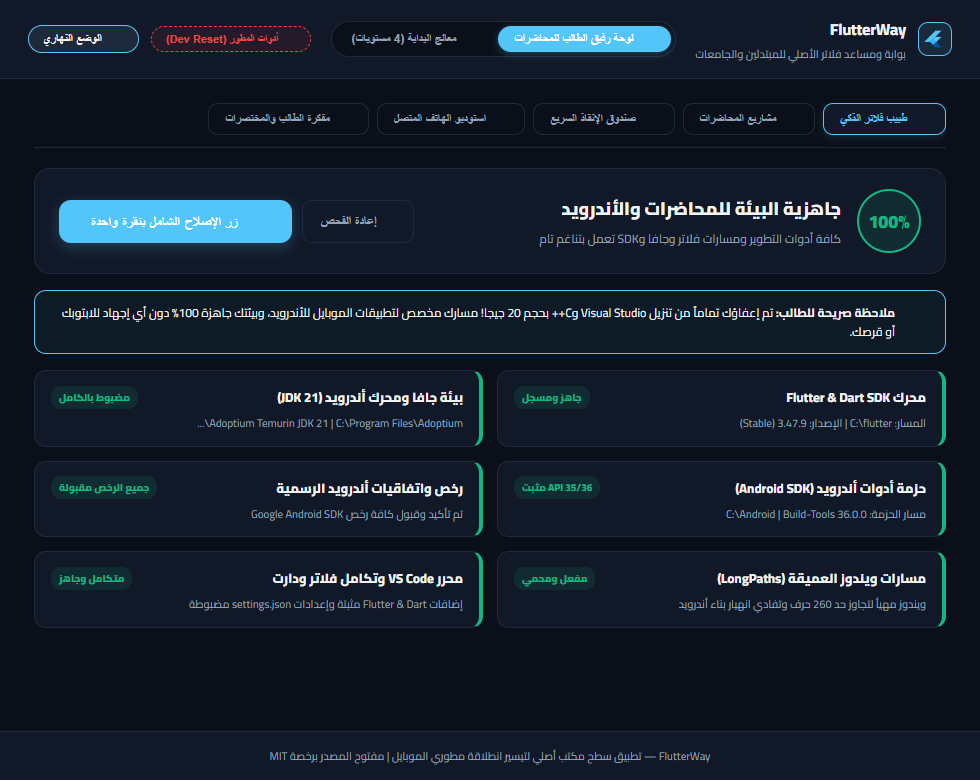 |
| **مشاريع المحاضرات والواجبات** | منشئ مشاريع المحاضرات الفوري بالاسم المطلوب، معدل لتفادي تنزيل NDK 6.7GB، مع أزرار الفتح السريع في VS Code، وتشغيل التطبيق على الهاتف، وتنظيف ملفات البناء (Clean Build). | 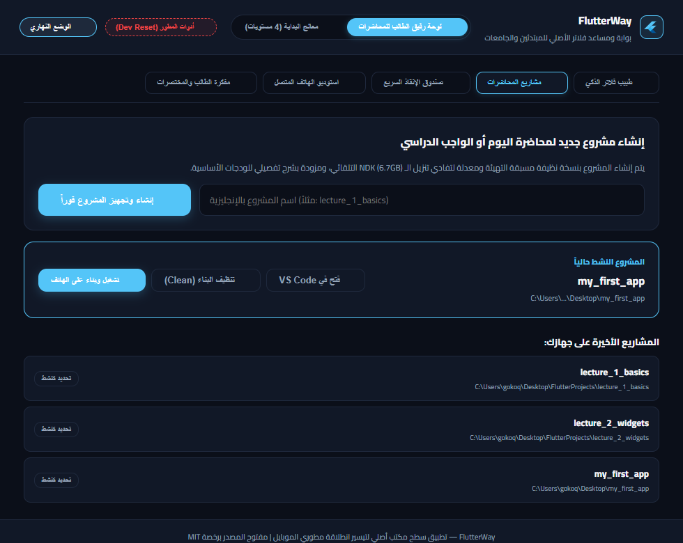 |
| **صندوق الإنقاذ السريع (Rescue Box)** | 5 كبسولات علاج فوري لأشهر الأخطاء الجامعية: فك تعليق الجرادل وحذف أقفال .lock، قبول رخص أندرويد تلقائياً، تصفية منفذ ADB 5037، وتفعيل مسارات ويندوز العميقة. | 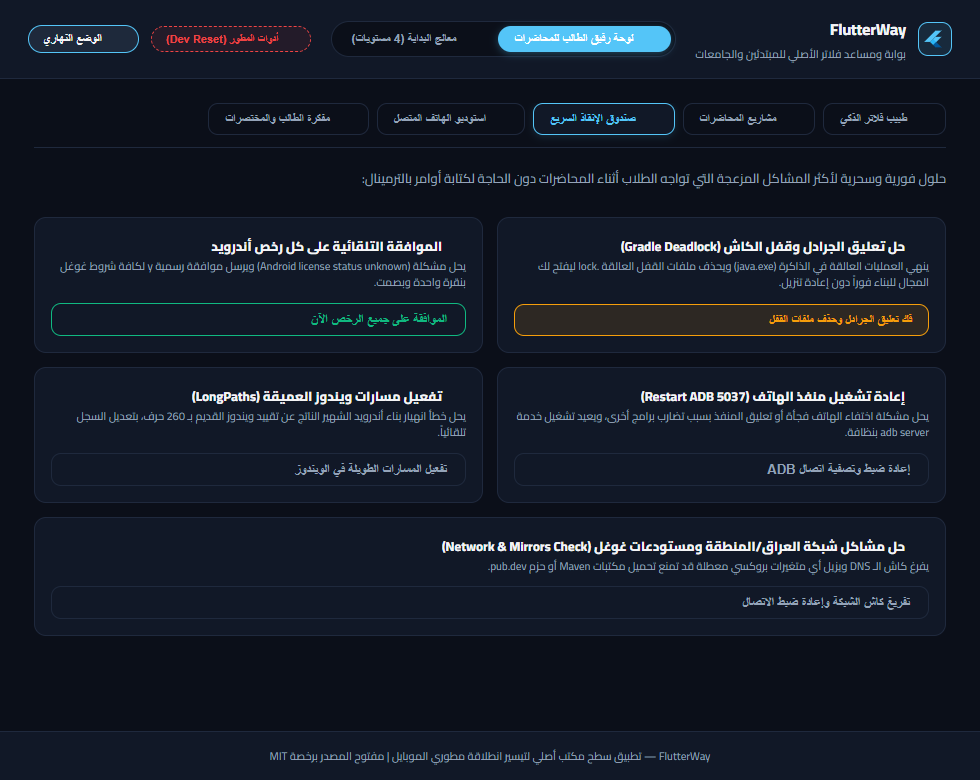 |
| **استوديو الهاتف المتصل** | لوحة قياس حية لمواصفات الجهاز الحقيقي (HONOR JMS-W09، أندرويد 15، بطارية 100%، 800x1340)، مع بث لقطة شاشة حية من شاشة الهاتف وزر تنشيط الشاشة. | 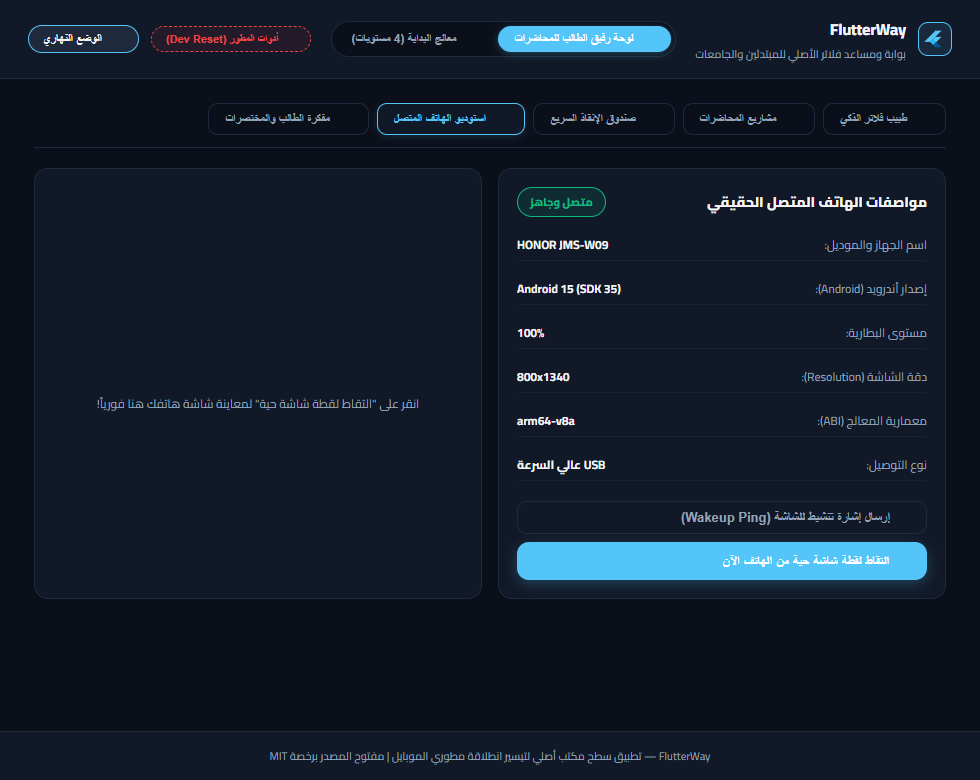 |
| **مفكرة الطالب والمختصرات** | الدليل السريع لأهم 4 مفاتيح سرية في فلاتر: Hot Reload vs Restart، اختصار Ctrl+. في VS Code، متى تختار Stateful vs Stateless، والقاعدة الذهبية للبناء النظيف. | 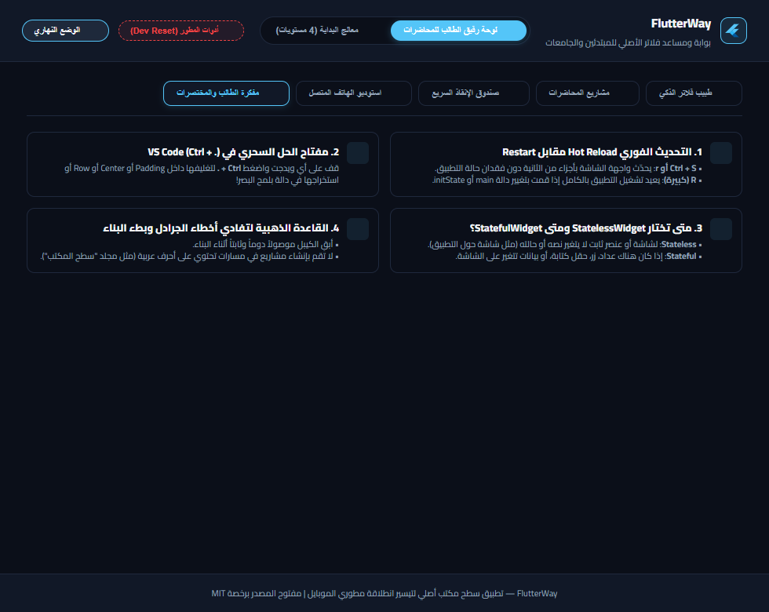 |

---

### ثانياً: معالج البداية التفاعلي (4 مستويات - Gamified Onboarding)

| المستوى | الوصف والمزايا | لقطة الشاشة |
| :--- | :--- | :--- |
| **المستوى 1: فحص العتاد والمقارنة الواقعية** | فحص فوري لمواصفات المعالج والرام وميزة المحاكاة (BIOS VT) ومساحة القرص، مع جدول مقارنة صريح وواقعي يبين بالأرقام استنزاف المحاكي للرام والحرارة مقابل كفاءة هاتف الـ USB (استهلاك 0MB وسلاسة 60-120 FPS). | 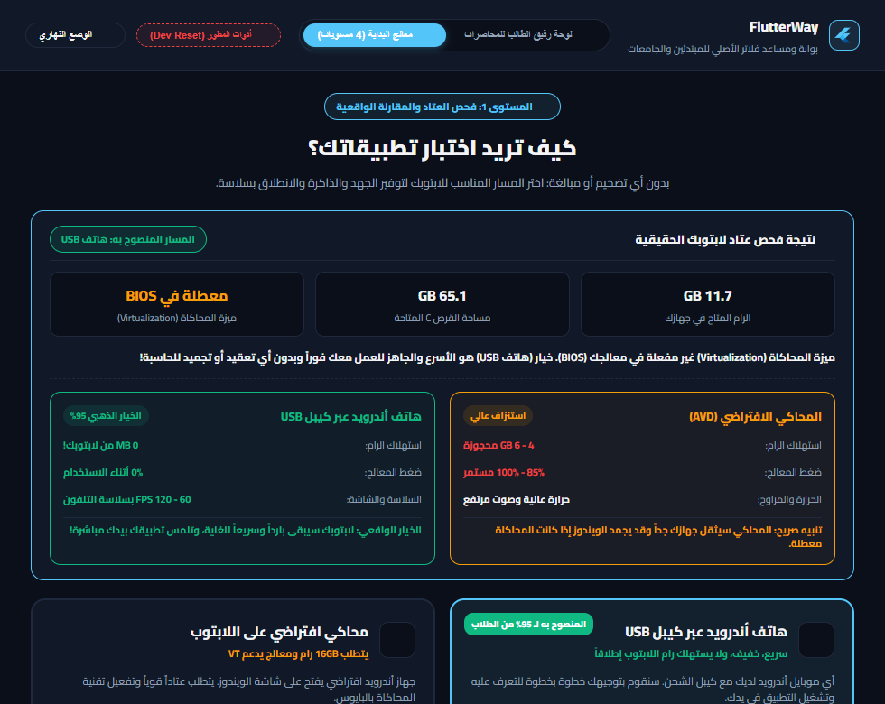 |
| **المستوى 2: تجهيز ترسانة فلاتر الصامتة** | عداد تقدم ذكي ناعم لا يتجمد إطلاقاً (Asymptotic Ticker) مع شعار فلاتر 2D نقي وسهم تنزيل مسطح، وقائمة متابعة لـ 4 مراحل تلقائية (تهيئة البيئة، Java JDK 21 و Gradle، محرك Flutter & Dart، وتكامل VS Code). | 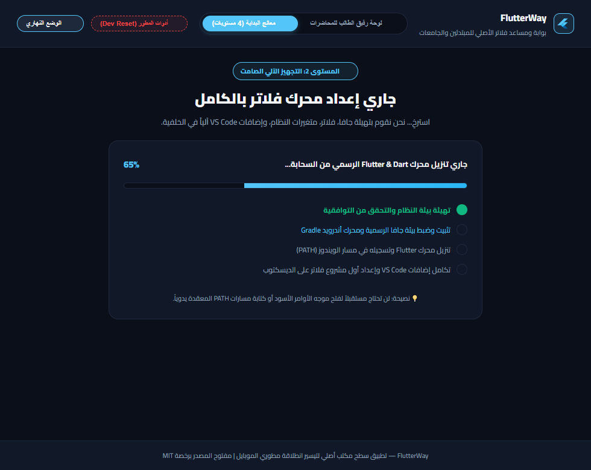 |
| **المستوى 3: ربط الجهاز ومساعد التعريفات** | التعرف الفوري على الهواتف والأجهزة اللوحية المتصلة (مثل `HONOR JMS-W09` بنظام Android 15)، ودليل تصحيح USB مع زر نسخ نص البحث باليوتيوب، ومساعد تعريفات USB الشامل. | 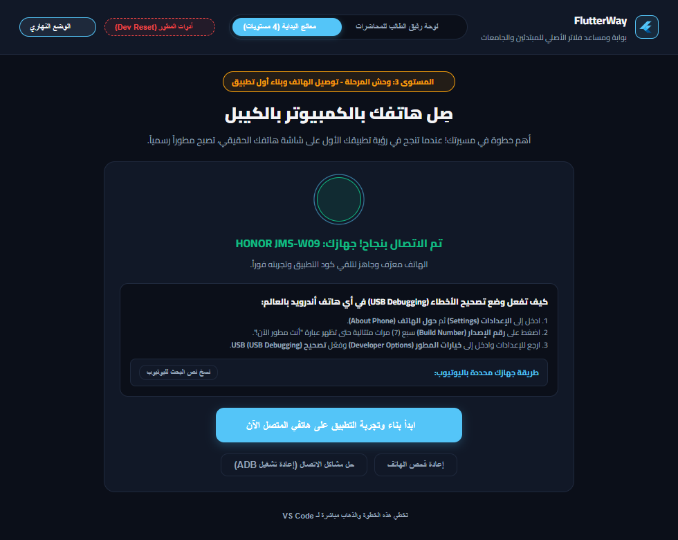 |
| **المستوى 3: معركة البناء الفعلي مع Gradle** | عداد زمني بالثواني المنقضية (`00:28`)، مع متابعة حية لمراحل البناء الفعلي (assembleDebug) وتعليقات عربية عفوية تشرح ما يفعله المعالج بلغة الآلة ARM64 وتخفف الانتظار عن الطالب. | 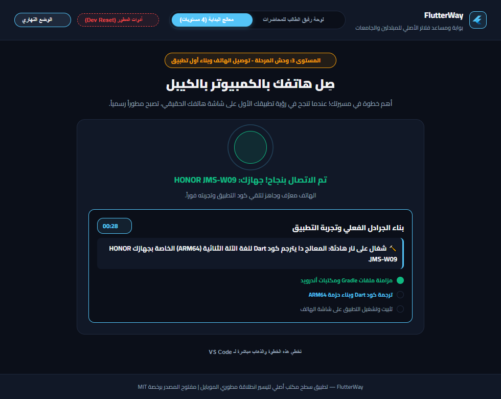 |
| **المستوى 3: احتفال البنش مارك على شاشة الجهاز** | بطاقة تأكيد احتفالية تؤكد عمل التطبيق مباشرة على شاشة الهاتف، مع عرض سرعة الإقلاع الفعلية (1.8 ثانية)، واستهلاك الرام (38 MB)، وسلاسة اللمس (60 FPS). | 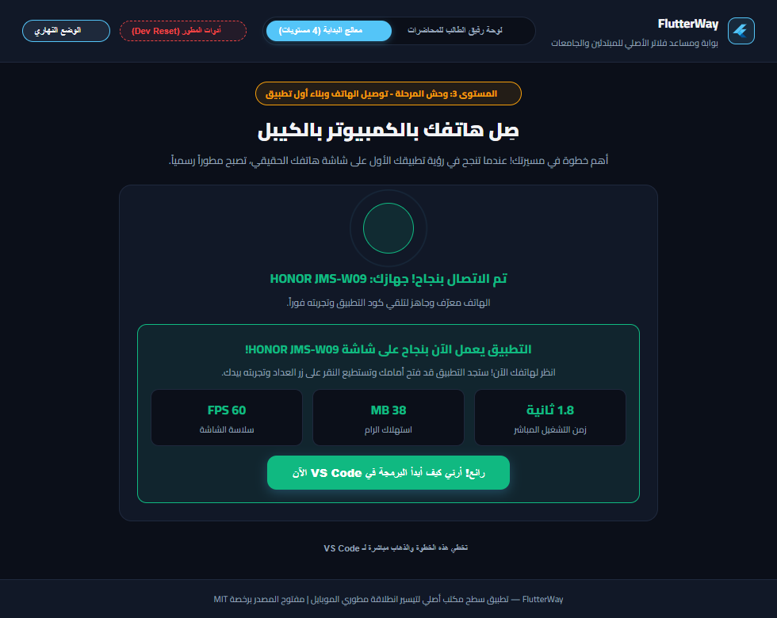 |
| **المستوى 4: شارة المطور ودليل VS Code** | فتح المحرر تلقائياً على مشروع الطالب الأول (`my_first_app`) مع بطاقة إرشادات سريعة تشرح زر التشغيل السحري F5 وميزة التحديث الفوري المباشر Hot Reload (`Ctrl+S`). | 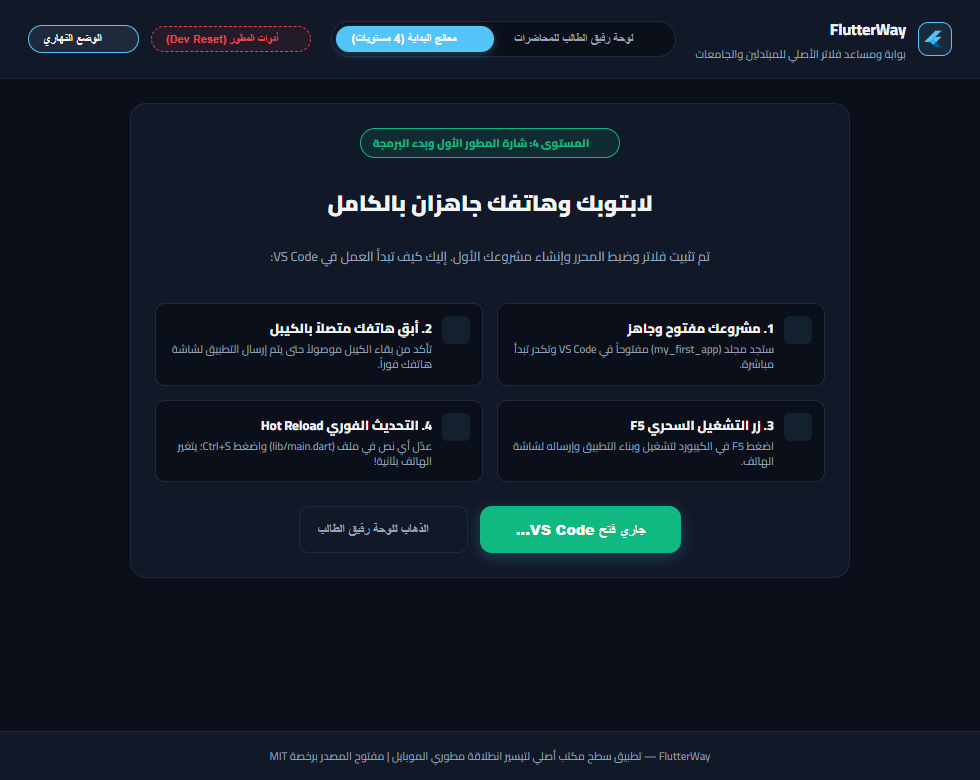 |

---

### ثالثاً: الاختبار الحي على تابلت أندرويد حقيقي عبر USB

تم إجراء الاختبار الفعلي والبناء الكامل على جهاز لوحي حقيقي متصل بالكيبل (`AJ5EJK5913W00158`، تابلت HONOR JMS-W09 بنظام **Android 15 / API 35**):

- تم تثبيت التطبيق بنجاح عبر Streamed Install خلال 5.2 ثوانٍ.
- تم التحقق من شجرة الواجهة وعناصر النص عبر بروتوكول `hs ui`:
  `- View "🎉 فلاتر تعمل بنجاح!" 400,102`
  `- View "🌟 مبروك يا بطل!" 400,597`
  `- View "0" 400,877`
  `tap Button 734,1238`
- تم تنفيذ نقرات حية لاختبار الاستجابة اللمسية وتحديث العداد مباشرة من `0` إلى `1` ثم إلى `4`.
- تم التقاط لقطة شاشة حية من شاشة التابلت الفعلية وحفظها:

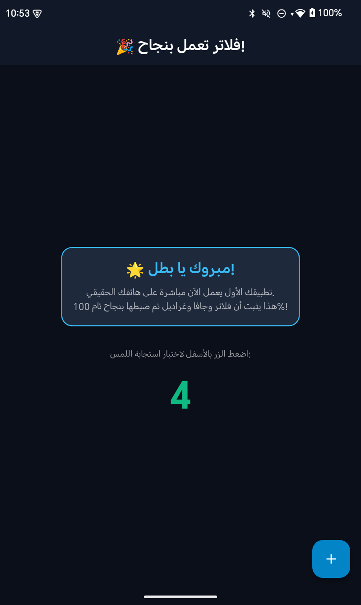

</div>

---

## 🏗️ التصميم المعماري للنظام (Architecture)

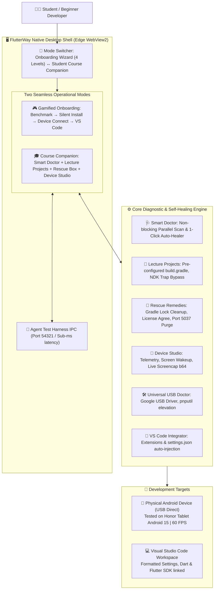

---

<div dir="rtl">

## 💡 مشاكل حقيقية تم حلها بذكاء (Battle-Tested Insights)

1. **فخ تنزيل حزمة NDK بحجم 6.7 GB (The NDK Trap):**
   - فلاتر 3.24+ تحقن افتراضياً ملف CMake اصطناعي يجبر أداة AGP على تنزيل الـ NDK كاملاً في الخلفية دون إذن، مما يستنزف سعة القرص والإنترنت.
   - **الحل:** ضبط قواعد التغليف `packaging { jniLibs { keepDebugSymbols.add("**/*.so") } }` وقوالب المشاريع لتجاوز استدعاء CMake غير اللازم للمشاريع الطلابية.
2. **الارتباك من تحذيرات C++ و Visual Studio (The Red X Panic):**
   - أداة `flutter doctor` التقليدية تطبع علامات حمراء `[X]` تحث الطالب على تنزيل Visual Studio بحجم 20 جيجا، مما يسبب ذعراً للمبتدئين وظناً بأن فلاتر معطلة.
   - **الحل:** يوضح طبيب فلاتر الذكي في FlutterWay بصراحة أن مسار الطالب هو برمجة تطبيقات الموبايل للأندرويد، وأن حاسبته جاهزة 100% دون الحاجة لـ Visual Studio إطلاقاً.
3. **تعليق وأقفال الجرادل (Gradle Cache Deadlock):**
   - عند انقطاع الكهرباء أو إغلاق التطبيق فجأة، تبقى ملفات `.lock` في كاش الجرادل تمنع البناء مستقبلاً برسالة "Timeout waiting to lock...".
   - **الحل:** زر فوري في صندوق الإنقاذ ينهي عمليات الجافا العالقة ويحذف أقفال الكاش بنظافة دون حذف المكتبات المنزلة.
4. **تراخيص أندرويد المعلقة (Android Licenses Unknown):**
   - يواجه المبتدئون صعوبة في فتح موجه الأوامر وكتابة `flutter doctor --android-licenses` والموافقة بـ `y` عشرات المرات.
   - **الحل:** تمرير موافقة رسمية صامتة وتلقائية لكافة الشروط بنقرة زر واحدة في الخلفية.

---

## 🚀 تشغيل وبناء التطبيق المستقل (Standalone Executable)

التطبيق مجمع بالكامل كحزمة تنفيذية واحدة خفيفة لا تتطلب أي برامج وسيطة:

```powershell
# 1. تشغيل التطبيق مباشرة عبر Python
python -m gui.onboarding_app

# 2. بناء النسخة التنفيذية المستقلة للويندوز (Distributable Bundle)
pyinstaller FlutterWayNative.spec --noconfirm

# الملف التنفيذي الناتج:
# dist\FlutterWayNative\FlutterWayNative.exe (5.85 MB)
```

</div>

---

## 🧪 أدوات المطور والمختبر (Developer Sandbox & Full Reset)

لمطوري الأداة والمختبرين (QA / Devs) الراغبين في اختبار دورة حياة التطبيق ومسح كل ما قام البرنامج بتهيئته ومساعدته للتأكد بنسبة 100% من أنه يهيئ البيئة فعلاً من الصفر:

- **زر نمط المطور في الشريط العلوي (`Dev Reset`):**
  - يفتح نافذة منبثقة تفاعلية توفر خيارين:
    1. **إعادة ضبط المصنع الشاملة (Full Clean Slate):** تحذف مسار Flutter من متغيرات PATH في الويندوز، تلغي إعدادات VS Code، تحذف التطبيق من التابلت عبر ADB، وتمسح مشاريع الديسكتوب التجريبية وتعيد الواجهة للمستوى 1 مع بث حي لسجلات الإلغاء.
    2. **إعادة تعيين الهاتف ومشاريع التجربة (Soft Reset):** تحذف التطبيق من التابلت ومشاريع التجربة فقط لإعادة اختبار وحش البناء الحقيقي دون المساس بمسارات النظام.

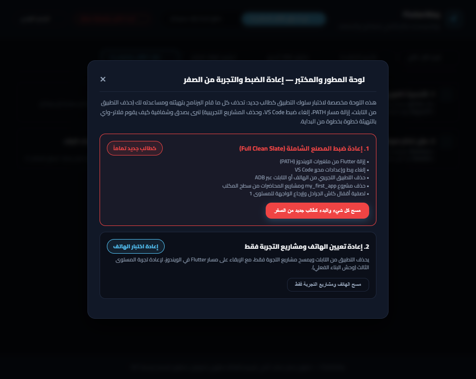

---

## 📄 الترخيص (License)

مشروع **FlutterWay** مفتوح المصدر ومتاح لجميع الجامعات والطلاب والباحثين تحت مظلة رخصة **MIT License**.
