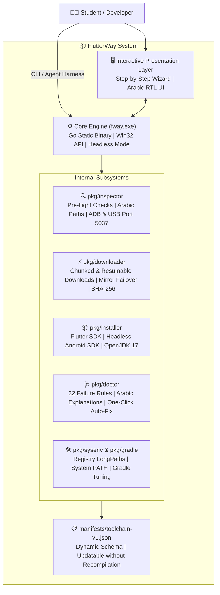

# FlutterWay 🚀 (طريق فلاتر)
> **The Zero-Friction Flutter & Android Setup Engine & Pipeline Diagnostic Assistant for Windows**  
> **محرك الإعداد الذكي، فحص مسار بناء الموبايل، والتشخيص الشامل لبيئة Flutter على Windows**

---

<div dir="rtl">

## 🌟 نبذة عن المشروع

تعتبر عملية إعداد بيئة عمل **Flutter & Dart** على نظام Windows كابوساً حقيقياً للطلاب والمطورين المبتدئين ("الصفر تماماً")، وتحديداً في البيئة الجامعية التي تعاني من بطء وتذبذب الإنترنت، وتجميد الحواسيب، وتعقيدات مسارات النظام والتراخيص ومحرك بناء أندرويد Gradle.

**مشروع FlutterWay** هو أداة هندسية حديثة صُممت خصيصاً للتخلص من كل هذه العوائق، من خلال:
1. **استقلالية تامة (Zero-Prerequisites):** تعمل كملف تنفيذي خالص لنواة ويندوز (Win32 Binary) مجمّع بلغة Go؛ دون الحاجة لأي سكريبتات PowerShell محظورة أو متطلبات مسبقة.
2. **تثبيت مقسم على دفعات وبروفايلات (Batched Profiles):** إمكانية اختيار **"بروفايل أجهزة USB فقط"** لتجهيز البيئة وتشغيل التطبيقات على الهاتف الحقيقي مباشرة وتوفير أكثر من 3.5GB وتجنب إرهاق الرام بالمحاكي الثقيل.
3. **موسوعة تشخيصية أوفلاين (Doctor AI Offline Rules):** فحص عميق لأكثر من **32 حالة فشل واقعية** مع تقديم شرح باللغة العربية البسيطة وزر للإصلاح الآلي بضغطة زر واحدة.
4. **دعم بيئة الجامعات والإنترنت الضعيف:** دعم وضع التثبيت من فلاشة USB بدون إنترنت نهائياً (Zero-Net Bundle)، والمرايا البديلة السريعة، ووضع العمل المحمول (Portable Mode) لمختبرات الكليات المحمية بـ Deep Freeze.

</div>

---

## 🏗️ Architecture & Component Overview (التصميم المعماري)



---

<div dir="rtl">

## 📊 مصفوفة المقارنة الهندسية (Comparison Matrix)

| الميزة / المقارنة | التثبيت اليدوي التقليدي | السكربتات العادية (.ps1/.bat) | محرك FlutterWay 🚀 |
| :--- | :--- | :--- | :--- |
| **سهولة الاستخدام للصفر** | معقدة ومحبطة جداً | تفتح نافذة سوداء مخيفة | معالج بصري وواجهة عربية ودودة |
| **مشكلة حظر السكربتات** | لا تنطبق | تفشل بسبب `ExecutionPolicy` | **تتجاوزها كلياً** (ملف Native PE) |
| **اسم المستخدم العربي والمسافات** | تكسر أندرويد و Gradle | تتجاهلها وتنهار لاحقاً | **كشف استباقي** وتوجيه لمسار آمن |
| **أندرويد ستوديو الثقيل** | إجباري تنزيل 1.5GB+ | يعتمد على أدوات متفرقة | **أدوات سطر الأوامر فقط** (خفيف وسريع) |
| **صراع منافذ ADB مع BlueStacks** | حلقة قتل لا نهائية لخادم adb | لا تتعامل معها إطلاقاً | **رصد واحتواء التضارب تلقائياً** |
| **بطء Windows Defender** | يبطئ البناء بنسبة 500% | يتطلب استثناء يدوياً | **إضافة استثناءات المجلدات بنقرة زر** |
| **أجهزة مختبرات الكلية (Deep Freeze)**| تضيع مع كل إعادة تشغيل | تضيع مع كل إعادة تشغيل | **وضع محمول (Portable Mode)** من فلاشة |
| **الإنترنت الضعيف / المحجوب** | يفشل التحميل من الصفر | يفشل مع أول انقطاع | **تحميل مجزأ مستأنف + مرايا بديلة** |

</div>

---

## 🗂️ Project Repository Layout (هيكل المستودع)

```text
flutterway/
├── cmd/
│   └── fway/                  # Main CLI entry point
├── pkg/
│   ├── manifest/              # Dynamic toolchain schema & hash verifier
│   ├── inspector/             # Pre-flight, Arabic user path, ADB & USB, WMI virtualization
│   ├── downloader/            # Multi-threaded chunked downloader with resume & mirrors
│   ├── installer/             # Flutter, Headless Android SDK, OpenJDK 17, Portable mode
│   ├── doctor/                # Offline rule engine (32 real-world failure patterns) & auto-fixers
│   ├── sysenv/                # Permanent Environment Variables & Registry LongPathsEnabled
│   └── gradle/                # Global gradle.properties tuner (OOM prevention, SSL CA fix)
├── manifests/
│   └── toolchain-v1.json      # Dynamic updatable toolchain specification
├── docs/
│   ├── ARCHITECTURE.md        # Detailed engineering and systems design document
│   ├── SRS_FAILURE_CATALOG.md # Forensic analysis of 32 real-world failure modes
│   └── ROADMAP.md             # SDLC implementation phases and deliverables
├── LICENSE                    # MIT License
└── README.md                  # Project documentation
```

---

<div dir="rtl">

## 🩺 موسوعة حالات الفشل المدعومة (Sample Supported Rules)

يغطي النظام أكثر من **32 حالة فشل واقعية** موثقة بالكامل في [وثيقة الـ SRS وموسوعة حالات الفشل](docs/SRS_FAILURE_CATALOG.md)، ومنها:

* **[FM-02] كسر المسارات بالأسماء العربية:** توجيه التثبيت تلقائياً لمسار `C:\dev\flutter` لمنع انهيار Gradle.
* **[FM-03] قيود ويندوز للمسارات (MAX_PATH):** تفعيل مفتاح `LongPathsEnabled = 1` في الـ Registry آلياً.
* **[FM-07] خطأ شهادات SSL بالجامعات (`PKIX failed`):** حقن مستودع شهادات الويندوز الرسمي في Gradle.
* **[FM-08] انهيار مسار Java في أندرويد ستوديو (`jbr` vs `jre`):** عزل OpenJDK 17 مع إنشاء وصلة رمزية لحل الخطأ.
* **[FM-11] احتكار محاكي الألعاب (BlueStacks/Nox) لمنفذ 5037:** رصد احتكار المنفذ وفكه تلقائياً.
* **[FM-16] بطء Windows Defender الخانق:** استثناء مجلدات الكاش والفلاتر لتقليص زمن البناء من 25 إلى دقيقتين.
* **[FM-17] تجمد قفل فلاتر (`startup lockfile deadlock`):** كشف وحذف ملف `lockfile` اليتيم وإنهاء العمليات العالقة.

</div>

---

## 📄 License & Credits (الترخيص)

هذا المشروع مرخص تحت رخصة **[MIT License](LICENSE)** — مفتوح المصدر ومتاح للاستخدام الأكاديمي والتطوير الحر.

تم تطوير وتصميم المخطط الهندسي بواسطة **[AboALhasanx](https://github.com/AboALhasanx)**.
