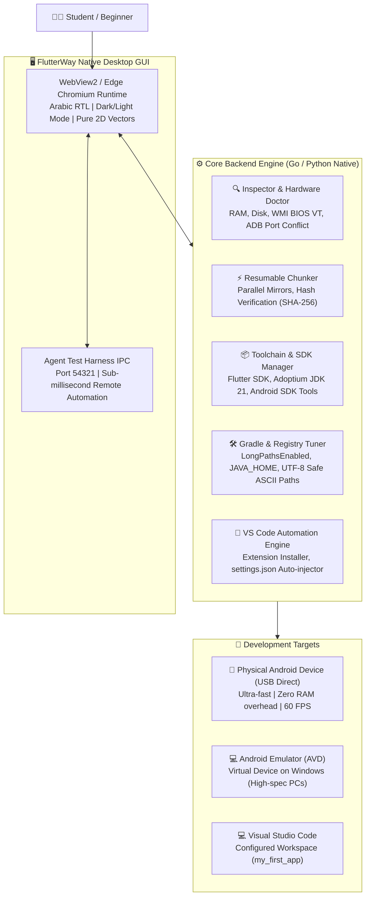

# FlutterWay (طريق فلاتر) 
> **Zero-Friction Flutter & Android Mobile Setup Engine & Beginner Onboarding Desktop App for Windows**  
> **التطبيق المكتبي والمحرك الذكي لتجهيز بيئة Flutter وتطبيقات الموبايل بضغطة زر واحدة للطلاب والمبتدئين**

---

<div dir="rtl">

## نبذة عن المشروع

تعتبر عملية إعداد بيئة عمل **Flutter & Dart** على نظام Windows كابوساً حقيقياً للطلاب والمطورين المبتدئين ("الصفر تماماً")، وتحديداً في البيئات الجامعية والبلدان النامية التي تعاني من بطء وتذبذب الإنترنت، وتجميد الحواسيب، وتعقيدات مسارات النظام والتراخيص ومحرك بناء أندرويد Gradle.

**مشروع FlutterWay** صُمم خصيصاً كحل جذري أصيل وخفيف الوزن، يدمج بين:
1. **تطبيق سطح مكتب أصلي حديث (Native Desktop App):** مبني بتقنية Edge Chromium الخفيفة (بدون استهلاك موارد Electron)، بواجهة عربية تفاعلية مصممة وفق أحدث معايير تجربة المستخدم وأيقونات فيكتور مسطحة (Pure 2D Vector) بدون أي تشويش بصري.
2. **محرك فحص وتشخيص خلفي (Go Core Engine):** يعمل كملف تنفيذي خالص لنواة ويندوز (Win32 Binary) مجمّع بلغة Go؛ دون الحاجة لأي سكريبتات PowerShell محظورة أو متطلبات مسبقة.
3. **دعم بيئة الهواتف الحقيقية عبر USB:** توجيه 90% من الطلاب لاستخدام هواتفهم الحقيقية مباشرة عبر كيبل USB بدلاً من المحاكيات الثقيلة التي تستهلك 4GB رام إضافية وتتطلب تفعيل Virtualization في الـ BIOS.
4. **بناء واختبار فعلي على الهاتف قبل كتابة الكود:** تجميع واختبار تطبيق فلاتر حقيقي على شاشة هاتف الطالب للتأكد من جاهزية Java وGradle وADB بنسبة 100%، مع ترجمة وشرح كافة المصطلحات التقنية بلغة عربية مبسطة وودودة للمبتدئ.

</div>

---

## 📸 معرض الواجهة وتجربة المستخدم (UI Tour)

<div dir="rtl">

### رحلة المستخدم المبسطة من 4 خطوات:

| الخطوة | الوصف والمزايا | الصورة |
| :--- | :--- | :--- |
| **1. فحص اللابتوب واختيار المسار** | فحص فوري في ثانيتين لمواصفات المعالج، الرام، ميزة المحاكاة (Virtualization) ومساحة القرص، واقتراح الخيار الأنسب لحاسوبك (هاتف USB فائق الخفة مقابل المحاكي). دعم كامل للوضع الليلي والنهاري. |  |
| **2. التجهيز التلقائي الصامت** | عداد تقدم ذكي ناعم لا يتجمد إطلاقاً (Asymptotic Ticker) مع نصائح دورية باللغة العربية تشرح مفاهيم فلاتر، وشعار 2D نقي مع سهم التنزيل، ومتابعة 4 مراحل ضبط تلقائية للمسارات وبيئة Java وGradle ومحرر VS Code. |  |
| **3. ربط الهاتف واختبار التشغيل الفعلي** | التعرف الفوري على الهاتف عبر USB، مع دليل مرئي لحل مشاكل الاتصال وتفعيل USB Debugging، وشرح مبسط لمفاهيم Java و Gradle و ADB للمبتدئين، مع إطلاق فعلي للتطبيق على شاشة الهاتف وقياس سرعة الإقلاع وسلاسة اللمس (60 FPS). |  |
| **4. دليل الانطلاق في VS Code** | فتح المحرر تلقائياً على مشروع الطالب الأول (`my_first_app`) مع بطاقة إرشادات سريعة تشرح زر التشغيل F5 وميزة التحديث الفوري المباشر Hot Reload (`Ctrl+S`). |  |

</div>

---

## 🏗️ التصميم المعماري للنظام (Architecture)



---

<div dir="rtl">

## 📊 مصفوفة المقارنة الهندسية

| وجه المقارنة | التثبيت اليدوي التقليدي | السكربتات العادية (.ps1/.bat) | تطبيق FlutterWay 🚀 |
| :--- | :--- | :--- | :--- |
| **سهولة الاستخدام للمبتدئ الصفر** | معقدة ومحبطة جداً | تفتح نافذة سوداء مخيفة | واجهة عربية ودودة من 4 خطوات |
| **سياسات الحظر بويندوز (ExecutionPolicy)** | لا تنطبق | تفشل بسبب الحظر | **ملف أصلي تنفيذي يتجاوز الحظر** |
| **المسارات العربية والمسافات** | تكسر أندرويد و Gradle | تتجاهلها وتنهار لاحقاً | **كشف استباقي** وتوجيه لمسارات ASCII آمنة |
| **أندرويد ستوديو الثقيل** | إجباري تنزيل 1.5GB+ | يعتمد على أدوات متفرقة | **أدوات سطر الأوامر فقط** (خفيف وسريع) |
| **صراع منافذ ADB مع BlueStacks** | حلقة قتل لا نهائية لخادم adb | لا تتعامل معها إطلاقاً | **زر فوري لفك الاحتكار وإعادة التشغيل** |
| **تفعيل بيئة Java و Gradle** | تتطلب ضبط يدوي لمتغيرات البيئة | تفشل إذا لم يكن JDK متاحاً | **ربط آلي لـ JDK 21 و JAVA_HOME** |
| **التحقق الفعلي على الموبايل** | يترك الطالب في حيرة | يفتح محرر الأكواد فقط | **بناء وتشغيل فعلي على شاشة الهاتف** |
| **أجهزة مختبرات الكلية (Deep Freeze)** | تضيع مع كل إعادة تشغيل | تضيع مع كل إعادة تشغيل | **وضع محمول (Portable Mode)** من فلاشة |

</div>

---

## 🗂️ هيكل المستودع (Repository Layout)

```text
flutterway/
├── assets/                    # Official 2D vector assets, test APKs & application icon
│   ├── flutter_logo.png       # Official 2D Flutter raster logo (225x225)
│   ├── starter_test_app.apk   # Prebuilt instant starter APK for physical verification
│   └── icon.ico               # Windows desktop application icon
├── cmd/
│   └── fway/                  # Go CLI entry point (headless & automation mode)
├── gui/
│   ├── onboarding/            # Modern HTML5/CSS/JS frontend application
│   │   ├── index.html         # 4-step wizard, 2D vectors, dark/light theme, RTL
│   │   └── flutter_logo.png   # Embedded logo asset
│   ├── onboarding_app.py      # Python Edge Chromium native app & IPC harness
│   ├── vscode_integration.py  # VS Code discovery, extension installer & settings injector
│   └── capture_screens.py     # Headless visual screenshot regression test suite
├── manifests/
│   └── toolchain-v1.json      # Dynamic updatable toolchain specification
├── pkg/
│   ├── doctor/                # Offline rule engine (32 real-world failure patterns)
│   ├── downloader/            # Multi-threaded chunked downloader with resume
│   ├── inspector/             # Pre-flight hardware checks, ADB & USB detection
│   └── manifest/              # Manifest parser and SHA-256 integrity verifier
├── clean_slate.py             # Zero-state student machine test & reset suite
├── LICENSE                    # MIT License
└── README.md                  # Comprehensive project documentation
```

---

<div dir="rtl">

## 🚀 تشغيل وتجربة التطبيق (Quick Start)

### 1. تشغيل التطبيق المكتبي مباشرة:
```powershell
python gui/onboarding_app.py
```
أو تشغيل الملف التنفيذي المجمّع:
```powershell
.\dist\FlutterWayNative\FlutterWayNative.exe
```

### 2. محاكاة حاسبة طالب جديد من الصفر (Clean Slate Test):
لتفريغ أي إعدادات سابقة واختبار التطبيق كما لو كان يعمل على جهاز طالب لم يثبت فلاتر من قبل:
```powershell
python clean_slate.py
```

### 3. أتمتة الفحص البصري التلقائي (Playwright Visual Suite):
لالتقاط صور عالية الدقة لكافة شاشات التطبيق للتأكد من سلامة التصميم:
```powershell
python gui/capture_screens.py
```

---

## 📄 الترخيص (License)

هذا المشروع مرخص بالكامل تحت رخصة **[MIT License](LICENSE)** — مفتوح المصدر ومتاح للاستخدام الأكاديمي، والمختبرات الجامعية، والتطوير الحر.

تم التطوير والتصميم بواسطة **[AboALhasanx](https://github.com/AboALhasanx)**.

</div>
