# FlutterWay

> A Windows desktop companion for setting up Flutter and Android development, creating course projects, diagnosing common build issues, and running apps on a USB-connected Android device.

**Documentation:** [English](README.md) | [العربية](README.ar.md)

---

## Overview

Setting up Flutter and Dart on Windows can be difficult for students and first-time developers, especially on machines with limited storage, unreliable internet, or unfamiliar Android tooling. Problems also continue after installation: Gradle locks, Android license prompts, device authorization, USB drivers, and oversized downloads can interrupt coursework.

FlutterWay brings the setup and common student workflows into one Windows app. Its interface is currently in Arabic and is designed for students learning Flutter.

### Guided onboarding

1. **Check the laptop:** inspect memory, disk space, virtualization support, and the recommended physical-device or emulator path.
2. **Prepare the toolchain:** set up Java, Flutter, Android SDK components, and VS Code integration.
3. **Connect and build:** detect Android devices, explain USB debugging, and build and install a real app.
4. **Start coding:** open the starter project and introduce VS Code and Flutter hot reload.

### Student course companion

- **Smart Doctor:** inspect the development environment and offer guided repairs.
- **Lecture Projects Studio:** create course and assignment projects, open them in VS Code, run them on a device, and clean build outputs.
- **Rescue Box:** guided actions for common Gradle, Android license, ADB, long-path, and network-cache problems.
- **Connected Device Studio:** show device information and capture or wake the connected device screen.
- **Student Cheatsheet:** concise references for hot reload, VS Code shortcuts, widget types, and build troubleshooting.

---

## Screenshots

### Course companion

| Area | Screenshot |
|---|---|
| Smart Doctor | 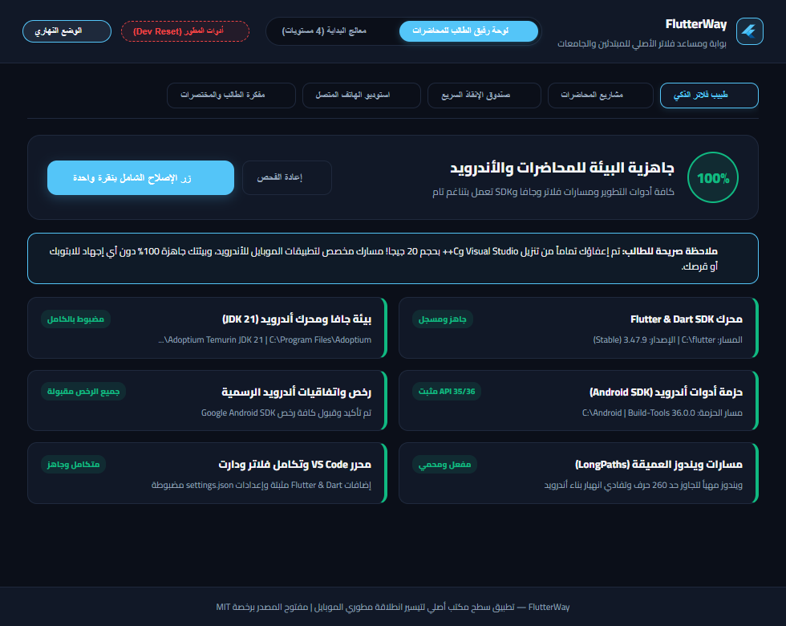 |
| Lecture projects | 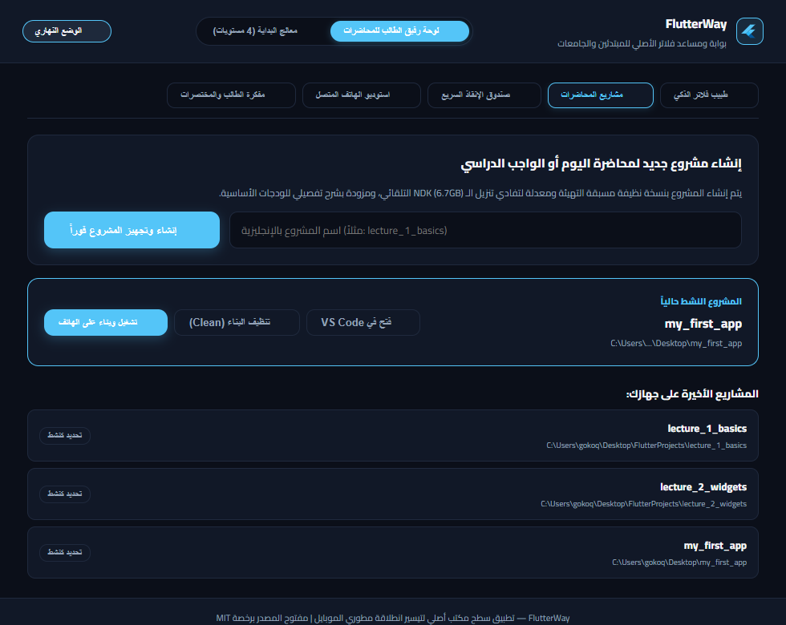 |
| Rescue Box | 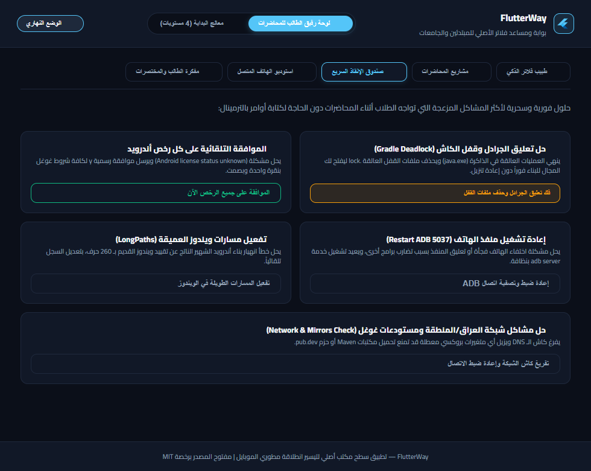 |
| Connected device | 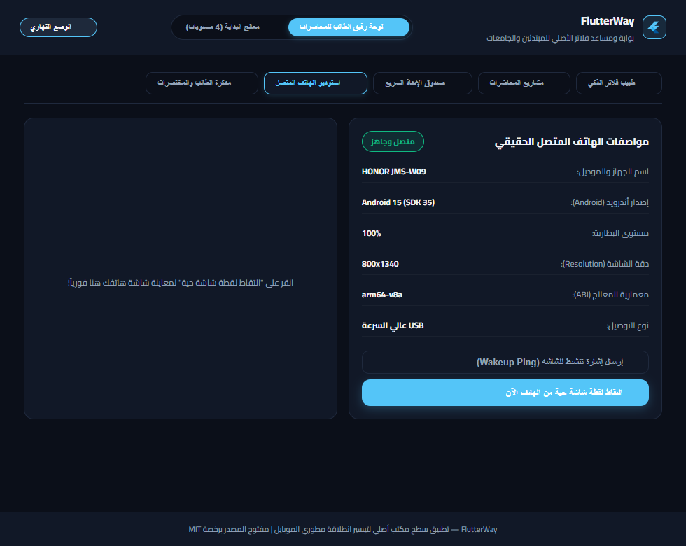 |
| Student cheatsheet | 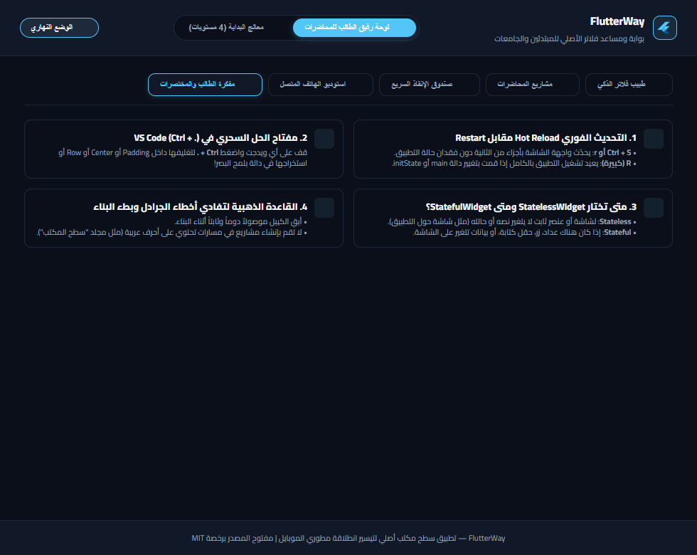 |

### Onboarding

| Step | Screenshot |
|---|---|
| Laptop check | 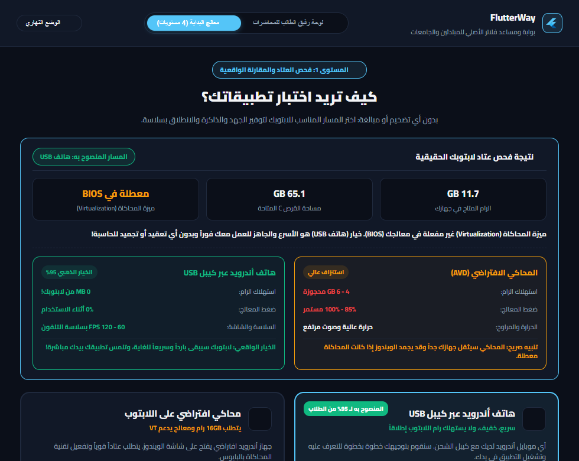 |
| Setup progress | 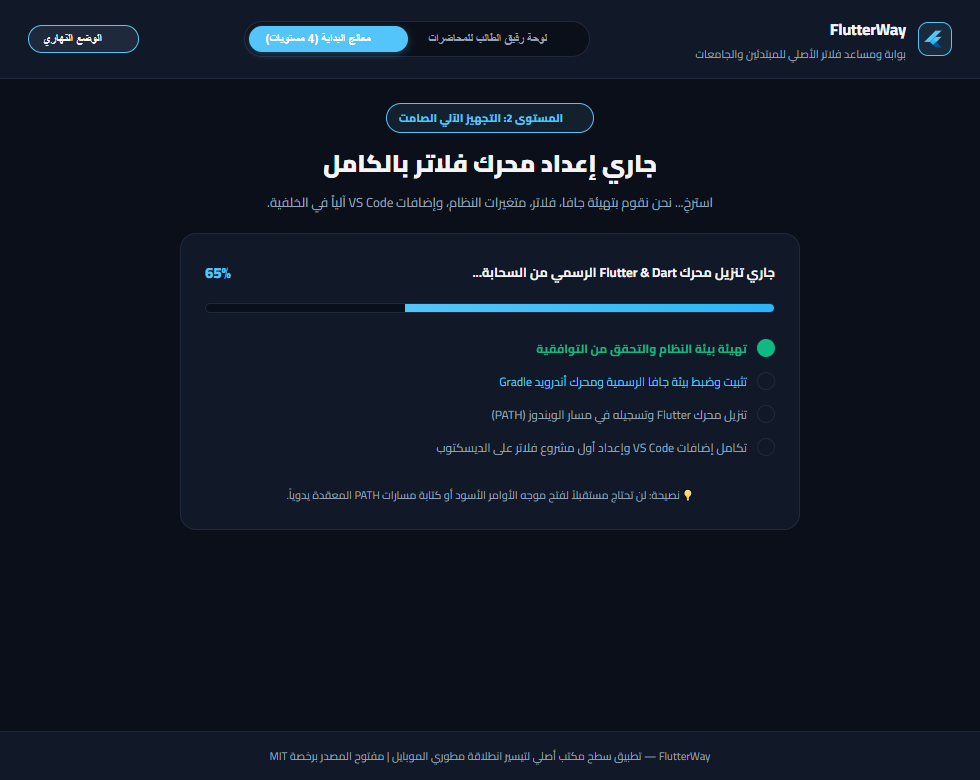 |
| Connected Android device | 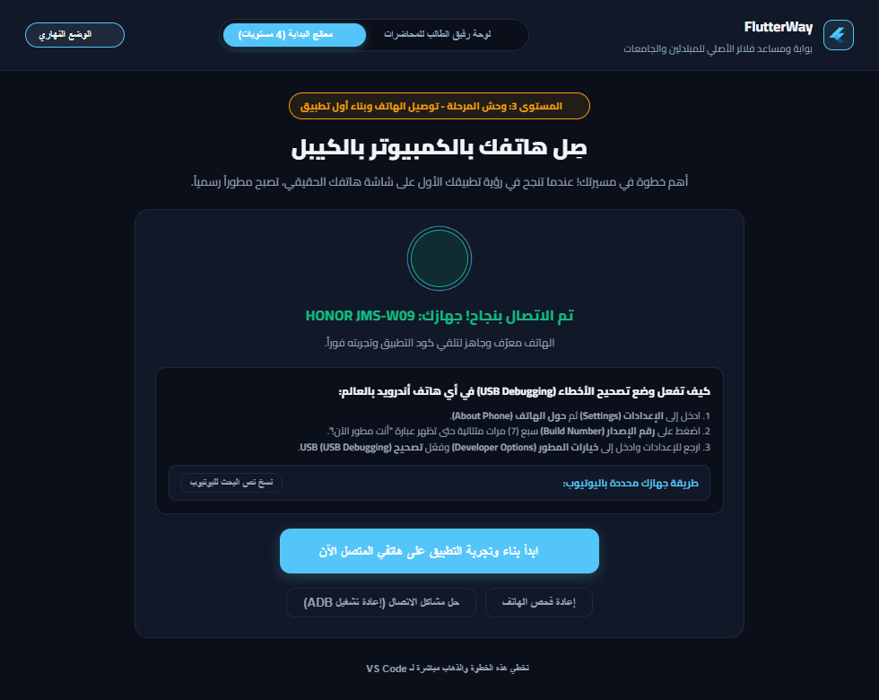 |
| Build output | 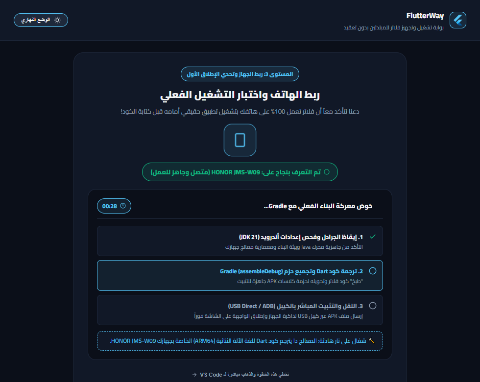 |
| VS Code guide | 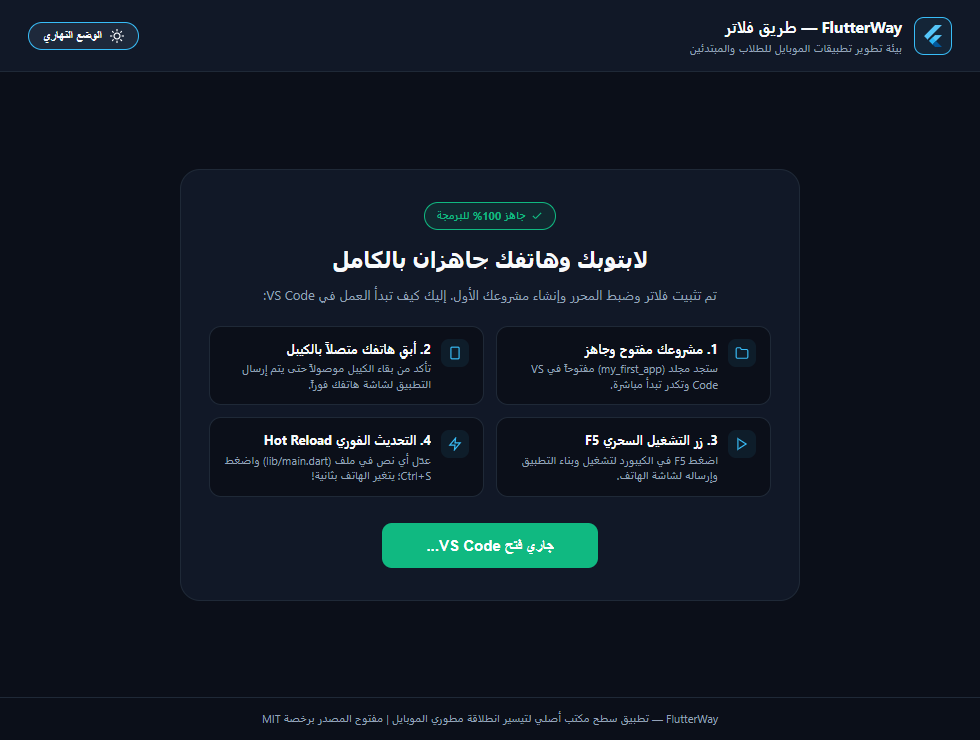 |

### Real-device verification

The app has been built, installed, and exercised on a physical HONOR JMS-W09 tablet running Android 15 (API 35). Device-specific evidence and test limits are recorded in the repository's test documentation.

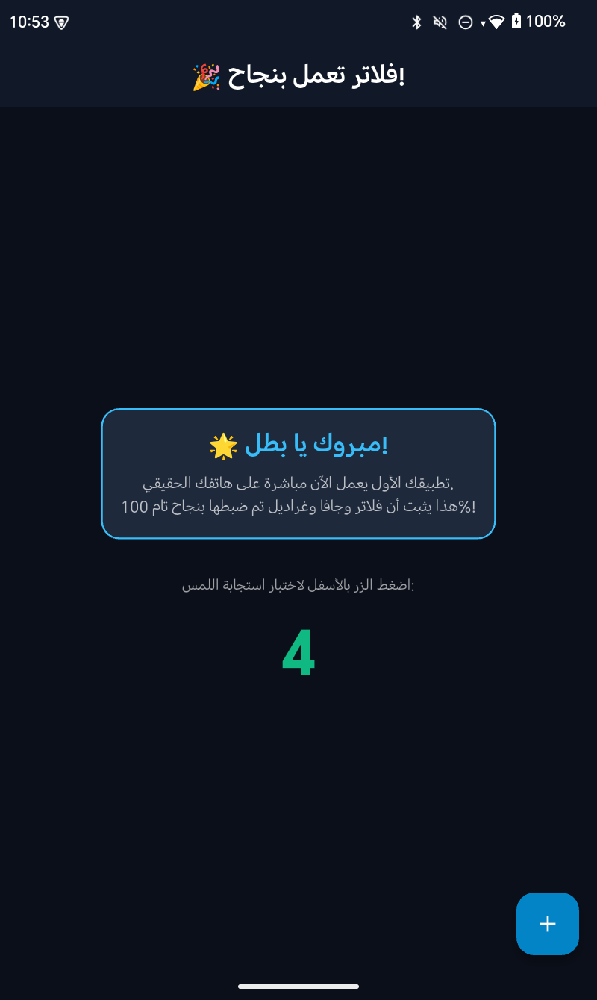

---

## Architecture and current implementation

The **implemented desktop app** is Python + pywebview, with a local HTML/JavaScript interface and Windows WebView2. Flutter and Android setup operations are implemented in Python modules under `gui/`.

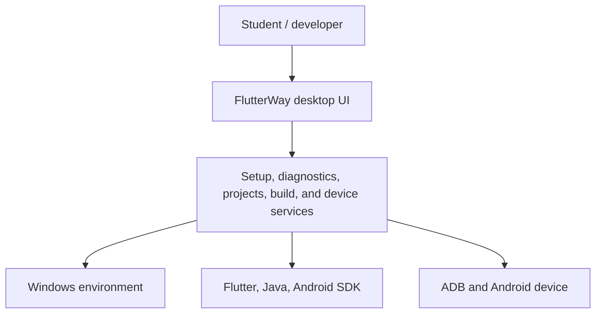

> **Future architecture note:** the Go engine, `fway.exe` CLI, and dynamic manifest described in some design documents are not the current app implementation. See [the roadmap](docs/ROADMAP.md) for status.

---

## Download

Get the latest files from [GitHub Releases](https://github.com/AboALhasanx/flutterway/releases/latest). Releases may include a single-file Windows installer and a portable ZIP bundle.

- The installer is per-user and does not require administrator privileges.
- Uninstalling FlutterWay is designed to preserve the user's SDKs, projects, and data under `%LOCALAPPDATA%\FlutterWay`.
- **Recommended:** use the single-file installer. If you use the portable ZIP, verify its SHA-256 first, then right-click the downloaded ZIP → **Properties** → select **Unblock** → **Apply**, and only then extract it. Windows may otherwise propagate its Internet download marker to `Python.Runtime.dll`, preventing the app's .NET component from starting. If you already extracted it, unblock the ZIP and extract a fresh copy.
- **SmartScreen:** unsigned releases can show a “Windows protected your PC” warning. A single-file installer does not remove that warning; code signing and reputation are separate requirements. Verify downloads against the SHA-256 file published with the release.

---

## Build locally

Requirements: Windows, Python 3.12, and the dependencies used by the Windows CI workflow.

```powershell
# Run from source
python -m gui.onboarding_app

# Build the PyInstaller application bundle
python -m PyInstaller --clean --noconfirm FlutterWayNative.spec

# Build the single-file installer (Inno Setup 6.7.3)
ISCC.exe /DAppVersion=1.3.1 installer\FlutterWay.iss
```

Outputs:

- `dist\FlutterWayNative\` — portable application folder.
- `dist\installer\FlutterWay-Setup-v1.3.1-windows-x64.exe` — per-user installer.

The build version is defined in `gui/version.py`; keep the command-line version in sync when preparing a release.

---

## Developer and QA tools

Developer controls are hidden from the student interface and require `--dev` or `FLUTTERWAY_DEV=1`. They can modify local setup state and should only be used with test data and after reviewing the relevant action.

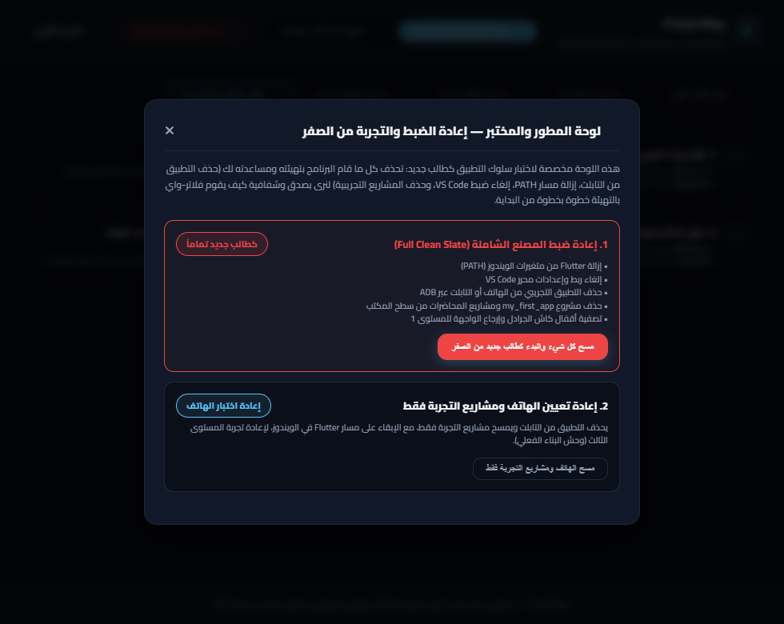

---

## Tests

Run the safe unit suite on Windows:

```powershell
python -m unittest discover -s tests -p "test_*.py" -v
```

Additional test and evidence documents:

| Document | Description |
|---|---|
| [Reliability tests](docs/RELIABILITY_TESTS.md) | Failure-injection and recovery coverage |
| [Clean-slate test](docs/CLEAN_SLATE_TEST.md) | Clean Windows environment test notes and limitations |
| [Error reporting](docs/ERROR_REPORTING.md) | Diagnostic reports and privacy considerations |
| [Agent automation plan](docs/AGENT_AUTOMATION_PLAN.md) | Future agent-agnostic CLI/JSON and MCP support |
| [User testing kit](docs/USER_TESTING_KIT.md) | Student session script, tasks, and scoring templates |
| [Heuristic review](docs/HEURISTIC_REVIEW.md) | UX review notes |

Hardware-dependent journeys require a real Android device. GitHub-hosted Windows CI verifies unit tests, packaging, and SDK/APK build workflows, but cannot verify USB interaction with a physical tablet.

---

## Roadmap

See [docs/ROADMAP.md](docs/ROADMAP.md). The agent-automation proposal is tracked in [GitHub Issue #1](https://github.com/AboALhasanx/flutterway/issues/1); it is planned work, not an implemented feature.

## License

FlutterWay is open source under the [MIT License](LICENSE).
