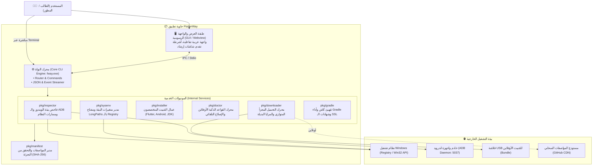

# التصميم المعماري لنظام FlutterWay (System Architecture)
> **النواة الهندسية لنظام الإعداد الذكي والتشخيص لبيئة Flutter & Android على Windows**
> **Architecture & Systems Design Specification (v1.0)**

> ⚠️ **هذا الملف رؤية مستقبلية، وليس وصفاً للكود الحالي.**
> التطبيق المنفّذ هو Python + pywebview في `gui/`، وليس محرك Go ولا `fway.exe` ولا manifest ديناميكي.
> راجع `README.md` و`docs/ERROR_REPORTING.md` للحالة الفعلية.

---

## 1. الفلسفة الهندسية (Engineering Philosophy)

صُممت أداة **FlutterWay** لمعالجة فشل أدوات الإعداد التقليدية (السكربتات والمثبتات القديمة) من خلال 4 مبادئ رئيسية:

1. **الاستقلالية التامة (Zero-Prerequisites & Self-Contained):**
   * لا تفترض الأداة وجود PowerShell مفعل، أو صلاحيات مطلقة، أو أدوات Git أو .NET مثبتة مسبقاً. تعمل كملف تنفيذي مستقل (Single Static Binary) مجمّع بلغة Go للنظام مباشرة (Win32 PE x86_64).
2. **الفصل التام بين المحرك والواجهة (Decoupled Core):**
   * جميع العمليات الثقيلة (الفحص، التحميل المجزأ، الـ Registry، فحص ADB) تدار داخل محرك CLI مستقل يدعم واجهة الأوامر وخروج الـ JSON المهيكل، مما يسهل اختباره وبرمجته بالـ Agents.
   * الواجهة الرسومية (GUI) هي مجرد طبقة عرض تفاعلية خفيفة ترتكز على المحرك.
3. **المواصفات الديناميكية (Dynamic Manifest Engine):**
   * الإصدارات والروابط وقواعد التشخيص ليست مشفرة في كود البرنامج (No Hardcoding). بل تقرأ من ملف مواصفات ديناميكي (`manifest.json`) قابل للتحديث الفوري عبر GitHub أو محلياً.
4. **التشخيص الاستباقي والأوفلاين (Offline-First Diagnostics):**
   * معالجة كافة حالات الفشل (32 حالة) دون الحاجة للاتصال بالإنترنت، عبر قاعدة معارف محلية ذكية ومحرك إصلاح آلي بضغطة زر.

---

## 2. مخطط البنية المعمارية (C4 Container Diagram)

---

## 3. تفاصيل الموديولات البرمجية (Package Architecture)

### 1. موديول الفحص (`pkg/inspector`)
* `system.go`:
  * فحص مسار اسم المستخدم `%USERPROFILE%` للتأكد من خلوه من المحارف العربية والمسافات.
  * فحص مساحة القرص الفارغة في `C:` و `D:` (التأكد من توفر >= 10GB).
  * فحص وجود مكتبة `mfplat.dll` للتأكد من عدم وجود نسخة Windows N الناقصة.
* `adb.go`:
  * فحص احتكار المنفذ `5037` وكشف العمليات المتعارضة (BlueStacks, Nox, LDPlayer).
  * حصر الأجهزة المتصلة وتحديد حالتها (`device`, `unauthorized`, `offline`).
* `virtualization.go`:
  * الاستعلام عبر WMI عن دعم المحاكاة العتادية (`VirtualizationFirmwareEnabled`).

### 2. موديول التحميل (`pkg/downloader`)
* `chunker.go`:
  * تقسيم الملفات الكبيرة (مثل Flutter SDK و Android Tools) إلى أجزاء (Chunks) وتنزيلها بشكل متوازٍ.
  * دعم استئناف التحميل (HTTP Range Request / Resume) لحماية الطالب من انقطاع النت في العراق والجامعات.
* `mirror.go`:
  * قياس زمن استجابة (Latency) خوادم جوجل مقارنة بالمرايا البديلة، والتبديل التلقائي عند الحجب أو البطء.
* `verifier.go`:
  * حساب ومطابقة بصمة التجزئة الرقمية `SHA-256` لضمان سلامة الملفات المحملة بنسبة 100%.

### 3. موديول التثبيت (`pkg/installer`)
* `flutter.go`: فك حزمة فلاتر، وتفعيل سياسة ملكية Git الآمنة (`git safe.directory`).
* `android_sdk.go`: تثبيت `cmdline-tools`، وتصحيح هيكل مجلد `latest`، وتمرير الموافقة الصامتة للتراخيص.
* `jdk.go`: تثبيت Microsoft OpenJDK 17 LTS وتعيين متغير `JAVA_HOME`.
* `portable.go`: تهيئة البيئة للتشغيل المحمول من فلاشة USB في أجهزة المختبرات (Deep Freeze).

### 4. موديول التشخيص المحلي (`pkg/doctor`)
* `rules.go`: قاعدة معارف محلية تضم أنماط الـ Regex للأخطاء الـ 32 الشائعة.
* `engine.go`: تحليل نتائج الفحص وإصدار تقرير عربي/إنجليزي مرمز بالألوان مع شارات النجاح والتحذير.
* `fixer.go`: تنفيذ أوامر الإصلاح الآلية بنقرة واحدة (One-Click Auto-Fix).

---

## 4. نموذج بيانات المانيفست الديناميكي (Manifest Schema)

تعتمد الأداة على نموذج بيانات JSON صارم يحدد:
* روابط الحزم لكل قناة (stable, beta).
* التوافقية بين إصدار فلاتر والحد الأدنى لنسخة Java (JDK 17).
* باقات البروفايل (بروفايل أجهزة USB فقط بحجم 220MB مقابل بروفايل المحاكي الكامل بحجم 3.8GB).
* شروط وقواعد محرك الـ Doctor.
